<p align="center">
  
</p>

<div align="center">

# MugiHub

**A compact black-and-white UI library for Roblox script hubs, with a built-in SVG icon pack.**

Monochrome gradient theme · Animated glowing border · SVG icons everywhere · Any image link · Window background · Customizable bubble · Popup color picker · HWID/account configs · Optional webhook · Zero dependencies

[](https://luau-lang.org/)
[](https://www.roblox.com/)
[](#icon-gallery)
[](#license)

</div>

---

## Table of Contents

- [Overview](#overview)
- [Library Info](#library-info)
- [Features](#features)
- [Installation](#installation)
- [Quick Start](#quick-start)
- [Window API](#window-api)
- [Icons](#icons)
- [Images and Links](#images-and-links)
- [Window Background](#window-background)
- [Bubble (Minimize Button)](#bubble-minimize-button)
- [Tags API](#tags-api)
- [Tab and Section API](#tab-and-section-api)
- [Components](#components)
  - [Button](#button)
  - [Toggle](#toggle)
  - [Slider](#slider)
  - [Input](#input)
  - [Dropdown](#dropdown)
  - [Keybind](#keybind)
  - [Color Picker](#color-picker)
  - [Label / Progress / Paragraph / Separator / Line / Social / Copy Group / ReadMe](#label--progress--paragraph--separator--line--social--copy-group--readme)
  - [Flags](#flags)
- [Configs (HWID + Account)](#configs-hwid--account)
  - [The easy way: one component](#the-easy-way-one-component)
  - [How HWID and account work](#how-hwid-and-account-work)
  - [Files](#files)
  - [Performance](#performance)
  - [API (without the component)](#api-without-the-component)
- [Color Picker Popup](#color-picker-popup)
- [Notifications](#notifications)
- [Search](#search)
- [Webhook (Optional)](#webhook-optional)
  - [What the Library Provides](#what-the-library-provides)
  - [Creating a Config](#creating-a-config)
  - [Multiple Configs](#multiple-configs)
  - [Registering Your Own Events](#registering-your-own-events)
  - [Sending Events](#sending-events)
  - [Custom Embeds](#custom-embeds)
  - [Attaching to Notifications](#attaching-to-notifications)
  - [Local Listeners](#local-listeners)
  - [Stats & Maintenance](#stats--maintenance)
  - [Full Method Reference](#full-method-reference)
  - [Any HTTP Endpoint Works](#any-http-endpoint-works)
  - [Security Note](#security-note)
- [Full Example](#full-example)
- [Icon Pack](#icon-pack)
- [Icon Gallery](#icon-gallery)
  - [Navigation (34)](#navigation-34)
  - [Actions (43)](#actions-43)
  - [Files (34)](#files-34)
  - [System (36)](#system-36)
  - [Settings (18)](#settings-18)
  - [Security (22)](#security-22)
  - [Status (25)](#status-25)
  - [Media (23)](#media-23)
  - [Social (21)](#social-21)
  - [Finance (23)](#finance-23)
  - [Nature (28)](#nature-28)
  - [Gaming (30)](#gaming-30)
  - [Roblox Ui (37)](#roblox-ui-37)
  - [Developer Tools (28)](#developer-tools-28)
  - [Transportation (26)](#transportation-26)
- [Validation Report](#validation-report)
- [Troubleshooting](#troubleshooting)
- [License](#license)

---

## Overview

MugiHub is a single-file Luau UI library for building script hub interfaces on Roblox. It ships with a searchable sidebar, a draggable window, a customizable minimize bubble, stacked notifications, a full set of ready-made components, a popup color picker, a config manager and an **optional** webhook layer.

Roblox cannot render `.svg` files, so the library carries its own icon engine: every icon is stored as compact path data inside `Mugi` and rasterized at runtime into small anti-aliased PNGs (3x supersampled, cached in `MugiHub/Cache/`) so edges stay smooth, and tinted to follow the UI colors. If the executor cannot write files or load custom assets, icons automatically fall back to rounded frames. No emoji and no font glyphs are used for icons anywhere.

No external dependencies. No build step. Just `loadstring` one URL.

## Library Info

| | |
|---|---|
| **File** | `Mugi` (loadstring) / `Mugi.lua` (same content) |
| **Language** | Luau |
| **Style** | Monochrome (black and white gradient), no pink, compact |
| **Icons** | 428 built in, 3 variants as `.svg` files in [`icons/`](icons) |
| **Exports** | `MugiHub.Library`, `MugiHub.Webhook` |
| **Executor functions used (all optional)** | `request`/`http_request`, `writefile`, `readfile`, `isfile`, `listfiles`, `delfile`, `makefolder`, `isfolder`, `getcustomasset`, `gethui`, `gethwid`, `setclipboard` |

Everything that depends on an executor function degrades quietly: if a function is missing the feature is skipped, never an error.

## Features

- **Draggable window** with a minimize bubble you can fully customize (icon name, SVG, or any image link)
- **Compact black + white gradient look** inspired by Rayfield Gen 2: section cards, white accents, no pink
- **Animated border** - a white gradient runs around the window edge while the stroke softly fades
- **Red rounded-square close button** with a clean X, plus minimize button and confirmation dialog
- **SVG icons only** for tabs, tags, buttons, notifications, search, dropdowns and the bubble
- **Any image link** for the window icon, bubble, tab icons and background (Dropbox, Google Drive, Imgur, GitHub, Pinterest pages, any URL that returns an image) - `rbxassetid` is optional
- **Custom window background** from any link, with transparency, dim and fit controls
- **Tags with icons** (static, dynamic and executor tags)
- **Buttons with a mouse-pointer icon** instead of an arrow, so they are never mistaken for dropdowns
- **Modern dropdown** with filter, multi-select, live `Refresh`, and an optional per-row **delete button**
- **Popup color picker** with saturation/brightness box, hue bar, hex, RGB, presets and cancel/done
- **Config manager** - name input, save, deletable dropdown of saved configs, load, auto load, auto save
- **Configs follow the device OR the account** - the same config stays available if either the HWID or the Roblox account changes
- **Global search**, **stacked notifications**, **ripple click**, and an **optional webhook**

## Installation

```lua
local MugiHub = loadstring(game:HttpGet("https://raw.githubusercontent.com/4MugiHub/MugiHub/refs/heads/main/Mugi"))()
```

- `MugiHub.Library` - the UI library
- `MugiHub.Webhook` - the optional webhook manager

> If you see `attempt to call a nil value` right after this line, it is almost always a stale GitHub raw cache. Wait about a minute and run again.

## Quick Start

```lua
local MugiHub = loadstring(game:HttpGet("URL_HERE"))()

local Window = MugiHub.Library:CreateWindow({
    "My Script",
    "A short tagline",
    105,
    UDim2.fromOffset(480, 275),
    Enum.KeyCode.RightControl,
    "hub",
})

local Tab = Window:AddTab({"Main", "home"})
local Section = Tab:AddSection("General")

Section:AddToggle({
    "Example Toggle",
    false,
    function(value) print("Toggle is now:", value) end
})

Section:AddConfigManager({})

MugiHub.Library:SetNotification({Type = "success", Content = "Loaded!", Delay = 3})
```

## Window API

```lua
local Window = MugiHub.Library:CreateWindow({
    "Window Title",             -- [1] Title
    "Subtitle text",            -- [2] Description
    105,                        -- [3] Tab width (pixels)
    UDim2.fromOffset(480, 275), -- [4] Size
    Enum.KeyCode.RightControl,  -- [5] Show/hide keybind
    "hub",                      -- [6] Icon: name, svg, asset id or any image link ("" to disable)
    {"TAG1", {"TAG2", "bolt"}}  -- [7] Tags (max 3), each text or {text, icon}
})
```

Named fields can be used instead of (or together with) positions:

| Field | Meaning |
|---|---|
| `Title`, `Description`, `Icon`, `Keybind`, `SizeUi`, `["Tab Width"]`, `Tags` | Same as the positional values |
| `Scale` | Window scale, default `0.9`, auto-fits small screens |
| `Background` | Background image link (see [Window Background](#window-background)) |
| `BackgroundTransparency` | Image transparency, default `0.35` |
| `BackgroundDim` | Black overlay transparency, default `0.45` |
| `BackgroundFit` | `"crop"` (default), `"fit"` or `"stretch"` |
| `Bubble` | Bubble icon: a string or `{Icon, Size, Position}` (see [Bubble](#bubble-minimize-button)) |

| Method | Description |
|---|---|
| `Window:SetTitle(text)` / `SetDescription(text)` | Update the header text |
| `Window:SetIcon(source)` | Change the header icon (name, svg, asset id or link; `nil` hides it) |
| `Window:SetBackground(source, {Fit, Transparency, Dim})` | Set or replace the background image |
| `Window:ClearBackground()` | Remove the background |
| `Window:SetBackgroundTransparency(n)` | Change background image transparency |
| `Window:SetBubbleIcon(source)` | Change the bubble icon at runtime |
| `Window:ColorPicker({Title, Color, Callback, OnDone, OnCancel})` | Open the popup color picker without a component |
| `Window:AddTab({name, icon})` | Create a tab |
| `Window:AddTabDivider(text)` | Group label between tabs |
| `Window:SelectTab(nameOrIndex)` | Switch tab from code |
| `Window:Toggle()` / `Window:SetOpen(bool)` | Show, hide or minimize |
| `Window:SetScale(0.5 - 1.5)` | Resize the whole window |
| `Window:Dialog({Title, Content, Buttons})` | Modal dialog; `Buttons = {{"Cancel"}, {"OK", callback, isDanger}}` |
| `Window:Destroy()` | Close and clean up everything |

When the window is closed, `MugiHub.Library.Unloaded` becomes `true`:

```lua
while not MugiHub.Library.Unloaded do task.wait(0.5) end
```

## Icons

Everywhere an icon is accepted you can pass **any** of these:

| Source | Example |
|---|---|
| Built-in name | `"sword"`, `"settings"`, `"shield-check"` |
| Alias (old short names still work) | `"combat"` -> `swords`, `"esp"` -> `eye`, `"gear"` -> `settings`, `"auto"` -> `refresh-cw` |
| Raw SVG path data | `"svg:M4 4L20 20M20 4L4 20"` |
| Full SVG text | `"<svg viewBox='0 0 24 24'><circle cx='12' cy='12' r='8'/></svg>"` |
| Roblox asset | `"rbxassetid://123456"` or just `123456` |
| Any image link | `"https://www.dropbox.com/..."`, Google Drive, Imgur, GitHub, ... |

Unknown icon names are skipped silently - they never raise an error.

```lua
local Tab = Window:AddTab({"Combat", "sword"})            -- built-in
local Tab2 = Window:AddTab({"Mine", "https://i.imgur.com/abc.png"})  -- image link

MugiHub.Library:RegisterIcon("logo", "svg:M12 3L21 8V16L12 21L3 16V8Z")
Window:AddTab({"Custom", "logo"})

print(MugiHub.Library:HasIcon("sword"))   -- true
print(#MugiHub.Library:GetIcons())        -- number of registered names
```

The SVG parser understands `M L H V C S Q T A Z` (absolute and relative), `<path>`, `<circle>`, `<ellipse>`, `<line>`, `<polyline>`, `<polygon>` and `<rect>`. Icons are stroke icons (stroke width 1.75 on a 24x24 grid); fills are not drawn for custom SVG text.

## Images and Links

The window icon, bubble, tab icons and the background all accept links. The library will:

1. Convert share links into direct links (Dropbox `raw=1`, Google Drive `uc?export=download`, GitHub `blob` to `raw`, Imgur page to image).
2. Download the bytes with the executor's `request`, detect PNG/JPG/GIF/WEBP by magic bytes, and cache the file in `MugiHub/Cache/` (hash-named, reused on the next run).
3. If the link is an HTML page (Pinterest and similar), read its `og:image` / `twitter:image` and use that picture instead.
4. Turn the cached file into an image with `getcustomasset`.

If anything fails (no HTTP, blocked site, not an image) the image is simply not shown - **no error is thrown**. `MugiHub.Library:ClearImageCache()` removes cached files.

> Executors need `request` (or `http_request`), `writefile` and `getcustomasset` for links. `rbxassetid` always works without any of them.

## Window Background

```lua
local Window = MugiHub.Library:CreateWindow({
    Title = "My Script",
    Icon = "hub",
    Background = "https://www.dropbox.com/scl/fi/xxxx/bg.png?rlkey=yyyy&dl=0",
    BackgroundTransparency = 0.35,   -- image
    BackgroundDim = 0.45,            -- black overlay
    BackgroundFit = "crop",          -- crop | fit | stretch
})

Window:SetBackground("https://i.imgur.com/abc.png", {Fit = "fit", Transparency = 0.5, Dim = 0.5})
Window:ClearBackground()
```

Pass a Pinterest/page link and the library uses the page's preview image.

## Bubble (Minimize Button)

The round draggable button shown when the window is minimized.

```lua
-- from the window icon (default)
MugiHub.Library:CreateWindow({"Title", "", 105, UDim2.fromOffset(480, 275), Enum.KeyCode.RightControl, "sword"})

-- fully custom
MugiHub.Library:CreateWindow({
    Title = "Title",
    Bubble = { Icon = "https://i.imgur.com/abc.png", Size = 48, Position = UDim2.new(0.05, 0, 0.1, 0) },
})

Window:SetBubbleIcon("shield")      -- change at runtime
Window:SetBubbleIcon("rbxassetid://123")
```

It stays inside the screen while dragging and keeps its animated border.

## Tags API

Accessible via `Window.Tags`. Tags can carry an icon.

```lua
local tag = Window.Tags:Add("LIVE", "zap")      -- text, icon
tag:Set("UPDATED")
tag:SetIcon("check-circle")
tag:Remove()

Window.Tags:AddDynamic("Players", function()
    return #game:GetService("Players"):GetPlayers()
end, 2, "users")                                 -- label, function, refresh seconds, icon

Window.Tags:AddExecutorTag(5, "cpu")             -- refresh seconds, icon (default "cpu")
```

Up to 3 tags are shown.

## Tab and Section API

```lua
local Tab = Window:AddTab({"Tab Name", "home"})
local Section = Tab:AddSection("Section Title")
local Collapsed = Tab:AddSection({Name = "Advanced", Collapsed = true})
```

Clicking a section header collapses or expands it. `Section:SetOpen(bool)` and `Section:SetTitle(text)` do the same from code. Tab icons are SVG icons that turn white when the tab is active.

## Components

Every component is created through a `Section` object. Every returned component also has `SetVisible(bool)`, `Destroy()` and `.Frame`.

### Button

```lua
Section:AddButton({
    "Do Something",
    "Runs a callback on click",
    function() end
})

Section:AddButton({Name = "Fast", Icon = false, Callback = function() end})       -- no icon
Section:AddButton({Name = "Save", Icon = "save", Callback = function() end})      -- custom icon
```

Buttons show a **mouse-pointer** icon on the right (so they are not confused with dropdowns). `Icon` accepts any icon source, or `false` to hide it. The returned object has `SetText(text)` and `SetIcon(source)`.

### Toggle

```lua
local Toggle = Section:AddToggle({ "Feature", false, function(value) end })
Toggle.Set(true)
print(Toggle.Get())
```

### Slider

```lua
local Slider = Section:AddSlider({ "Intensity", 0, 100, 50, function(value) end })

Section:AddSlider({ Name = "Speed", Min = 0, Max = 1, Default = 0.5, Increment = 0.1, Suffix = "", Callback = function(v) end })
```

### Input

```lua
local Input = Section:AddInput({ "Message", "Placeholder...", "", function(value) end })
Input.Set("hello")
print(Input.Get())
```

`Numeric = true` restricts the box to numbers.

### Dropdown

```lua
local Dropdown = Section:AddDropdown({
    "Mode",
    {"Option A", "Option B", "Option C"},
    "Option A",
    function(selected) print(selected[1]) end
})

Dropdown.Set("Option B")
print(Dropdown.Get()[1])
Dropdown.Refresh({"New 1", "New 2"}, true)   -- keepSelection
Dropdown.Open() Dropdown.Close() Dropdown.Clear()

local Multi = Section:AddDropdown({
    Name = "Hitboxes", Options = {"Head", "Chest", "Arms", "Legs"}, Default = {"Head"},
    Multi = true, Max = 3,
    Callback = function(selected) print(table.concat(selected, ", ")) end
})
```

Extra options:

| Option | Meaning |
|---|---|
| `Deletable = true` | Every row gets a trash icon button |
| `OnDelete = function(name) ... end` | Called when a row is deleted; return `false` to cancel |
| `ConfirmDelete = true` | Default `true`: first click arms the button (turns red), second click within about 2 seconds deletes |
| `DeleteIcon = "trash"` | Icon of the delete button |
| `Empty = "Nothing here"` | Text shown when the list is empty |
| `Filter = true` | Force the filter box (it appears automatically above 7 options) |

Only dropdowns created with `Deletable = true` have delete buttons, so normal dropdowns stay clean.

### Keybind

```lua
Section:AddKeybind({ "Toggle Key", Enum.KeyCode.E, function(key) end })
Section:AddKeybind({ Name = "Panic", Default = Enum.KeyCode.X, OnPress = function() end, Callback = function(key) end })
```

### Color Picker

```lua
local Picker = Section:AddColorPicker({ "ESP Color", Color3.fromRGB(255, 255, 255), function(color) print(color) end })
Picker.Set("#33CCFF")        -- Color3, hex string or {r, g, b}
print(Picker.Get())
Picker.Open()                -- open the popup from code
```

See [Color Picker Popup](#color-picker-popup).

### Label / Progress / Paragraph / Separator / Line / Social / Copy Group / ReadMe

```lua
local Label = Section:AddLabel("Plain text") Label.Set("New text")
local Bar = Section:AddProgress({"Loading", 25}) Bar.Set(80)             -- name, default, max (default 100)
local P = Section:AddParagraph({"Note", "Wrapped explanatory text."}) P.Set("New content")
Section:AddSeparator({"Advanced"}) Section:AddSeparator()
Section:AddLine()
Section:AddSocial({"Join Discord", "https://discord.gg/example", "rbxassetid://..."})
Section:AddCopyGroup({"Server IP", "play.example.com"})
Section:AddReadMe({"Getting Started", "Click to expand for setup instructions."})
```

### Flags

Give a component a `Flag` to include it in configs (toggle, slider, input, dropdown, keybind, color picker):

```lua
Section:AddToggle({Name = "Auto Farm", Default = false, Flag = "AutoFarm", Callback = function() end})
print(MugiHub.Library.Flags.AutoFarm)   -- live value
```

## Configs (HWID + Account)

### The easy way: one component

```lua
local Tab = Window:AddTab({"Config", "settings"})
local Section = Tab:AddSection("Configs")
Section:AddConfigManager({})
```

This adds, in one block:

1. **Config name** - type a name
2. **Saved configs** - dropdown of your configs, each row with a **trash icon** delete button (click once to arm, again to delete)
3. **Save config**, **Load config**, **Refresh list**
4. **Auto load on start** - loads the chosen config when the script runs
5. **Auto save changes** - saves the chosen config shortly after any flagged component changes

Options: `Name`, `InputName`, `DropdownName`, `AutoLoad = false` (never auto load), `AutoLoadDelay` (seconds, default `1.2`, gives your UI time to build before loading).

### How HWID and account work

When you save, the config stores a **hashed** fingerprint of the current **device (HWID)** and the current **Roblox account (UserId)**. A config is visible and usable when **either** one matches:

| Situation | Config available? |
|---|---|
| Same device, same account | Yes |
| Different device, same account | Yes (the account matches) |
| Same device, different account | Yes (the device matches) |
| Different device and different account | No |

Saving again from the new device/account adds it to the list (up to 8 each), so the config keeps following you. Raw HWIDs and UserIds are never written to disk, only one-way hashes. If `gethwid` is not available, a stable client id is used instead.

### Files

| Path | Content |
|---|---|
| `MugiHub/Configs/<name>.json` | One config (hashed owners + flag values) |
| `MugiHub/Configs/_index.json` | Fast index so listing never reads every file |
| `MugiHub/Configs/_settings.json` | Auto load / auto save pointers |
| `MugiHub/Cache/` | Downloaded images |

Configs from older versions in `MugiHub/*.json` are copied into the new folder automatically the first time.

### Performance

- The list comes from an in-memory index; the disk is scanned once and in the background.
- Writes are debounced (index and settings) and auto save waits 1.5 seconds after the last change.
- Loading applies about 6 values per frame so the game never hitches.
- Auto save is armed only after the UI is built and the auto load finished, so it can never overwrite a config with half-built defaults.

### API (without the component)

```lua
local Library = MugiHub.Library
local ok, name = Library:SaveConfig("legit")        -- returns true, cleanedName
Library:LoadConfig("legit", function(done, result) print(done, result) end)
Library:DeleteConfig("legit")                       -- true on success
print(Library:GetConfigs())                         -- names visible to this device/account
Library:RescanConfigs(function() end, true)         -- force rescan, callback when finished
Library:SetAutoLoad("legit")  Library:SetAutoLoad(nil)
Library:SetAutoSave("legit")  Library:SetAutoSave(nil)
Library:LoadAutoConfig(function(done, result) end)
Library:OnConfigsChanged(function() end)            -- returns an object with :Disconnect()
Library:RefreshOwner()                              -- re-read HWID/account (rarely needed)
```

Config names are cleaned to letters, digits, spaces, `-`, `_` and `.` (other characters become `_`). `SaveConfig` returns `false, reason` on failure, e.g. no `writefile`, an invalid name or a config owned by someone else.

## Color Picker Popup

Clicking a color row opens a popup centered in the window, over a dimmed backdrop:

- Saturation/brightness box and hue bar (mouse or touch)
- Hex field (`#RRGGBB` or `#RGB`) and R / G / B fields
- 8 preset colors
- Old vs new preview
- **Cancel** restores the previous color, **Done** (or the X, or clicking outside) keeps the new one

The callback fires live while you drag. It also works without a component:

```lua
Window:ColorPicker({
    Title = "Pick a color",
    Color = Color3.fromRGB(80, 160, 255),
    Callback = function(c) print("live", c) end,
    OnDone = function(c) print("final", c) end,
    OnCancel = function(c) print("cancelled", c) end,
})
```

## Notifications

```lua
MugiHub.Library:SetNotification({ Content = "Settings applied", Delay = 3, Time = 0.25 })
MugiHub.Library:SetNotification({ Title = "Update", Content = "Config saved", Delay = 4 })
MugiHub.Library:SetNotification({ Type = "success", Content = "Saved" })   -- success | error | warning | info
MugiHub.Library:SetNotification({ Content = "Custom icon", Icon = "bug" })
MugiHub.Library:SetNotification("A plain string works too")

local notif = MugiHub.Library:SetNotification({Content = "Loading...", Delay = 10})
notif:Close()
```

`Type` picks an SVG icon (check-circle, x-circle, alert-triangle, info); `Icon` overrides it with any icon source.

## Search

Every component registered through a section is searchable from the sidebar search box. Typing jumps to the matching tab, opens the section, scrolls it into view and highlights it.

---

## Webhook (Optional)

The webhook system is off by default and does nothing unless you create a config. It is designed for **you, the script author, to log events you choose to log** — it does not collect or send anything on its own.

### What the Library Provides

The library only supplies the mechanism:

- Sending a JSON payload to a URL
- Queueing and rate limiting so you never spam the endpoint
- Error handling (`pcall`-wrapped, never crashes your script)
- A way to attach player/game context to a message, if you opt in

**It ships with no pre-made event names, titles, or colors.** That part is entirely up to you — you register whatever events make sense for your script, with whatever text and color you want. This keeps the library generic and keeps you in control of what leaves the client.

### Creating a Config

```lua
local Log = MugiHub.Webhook:NewConfig("Log", {
    URL        = "https://discord.com/api/webhooks/ID/TOKEN",
    Enabled    = true,
    Username   = "My Script",
    AvatarURL  = "",
    SendPlayer = true,
    SendGame   = true,
    Timestamp  = true,
    RateDelay  = 2,
    QueueMax   = 50,
    Color      = 0xE6E6E6,
})
```

| Field | Default | Description |
|---|---|---|
| `URL` | `""` | Destination URL. Empty means the config never sends anything. |
| `Enabled` | `true` | Master on/off switch |
| `Username` | `"MugiHub"` | Display name shown as the sender |
| `AvatarURL` | `""` | Sender avatar URL |
| `SendPlayer` | `true` | Include Username, DisplayName, UserId, and an avatar link |
| `SendGame` | `true` | Include PlaceId, JobId, and executor name |
| `Timestamp` | `true` | Include a timestamp on every embed |
| `RateDelay` | `2` | Minimum seconds between requests |
| `QueueMax` | `50` | Maximum queued messages before new ones are dropped |
| `Color` | `0xE6E6E6` | Fallback embed color when an event has none |

`SendPlayer` and `SendGame` only ever include: Roblox username, display name, UserId, PlaceId, JobId, and the executor's name. Nothing else is collected — no passwords, cookies, tokens, or other client data.

### Multiple Configs

You can create as many independent configs as you need. Each has its own queue, rate limit, and event list — they never interfere with each other.

```lua
local ActivityLog = MugiHub.Webhook:NewConfig("ActivityLog", {
    URL = "https://discord.com/api/webhooks/AAA/BBB",
})

local ErrorLog = MugiHub.Webhook:NewConfig("ErrorLog", {
    URL   = "https://discord.com/api/webhooks/CCC/DDD",
    Color = 0xFF3333,
})
```

Retrieve a config you created earlier:

```lua
local ActivityLog = MugiHub.Webhook:Get("ActivityLog")
```

### Registering Your Own Events

The library has no built-in events. Register the ones your script needs:

```lua
Log:RegisterEvent("ButtonClicked", {
    title = "Button Clicked",
    color = 0xE6E6E6,
})

Log:RegisterEvent("ScriptLoaded", {
    title = "Script Loaded",
    color = 0x00FF99,
})
```

### Sending Events

```lua
Log:Send("ScriptLoaded")

Log:Send("ButtonClicked", {
    button = "Execute",
})
```

Sending an event that was never registered still works — it falls back to a plain title made from the event name and the config's default color.

### Custom Embeds

For a one-off message that doesn't need a registered event:

```lua
Log:SendEmbed({
    Title       = "Script Loaded",
    Description = "Everything initialized correctly.",
    Color       = 0xE6E6E6,
    Footer      = "My Script v1.0",
    Fields      = {
        { name = "Status", value = "Online", inline = true },
    },
})
```

Send several embeds in one request (Discord allows up to 10):

```lua
Log:SendEmbeds({
    { Title = "First",  Color = 0xE6E6E6 },
    { Title = "Second", Color = 0x99CCFF },
})
```

Plain text, no embed:

```lua
Log:SendContent("Hello from my script.")
```

Fully custom payload:

```lua
Log:SendRaw({
    username = "Custom",
    content  = "Raw payload example",
})
```

### Attaching to Notifications

Optionally forward every `SetNotification` call to a webhook automatically:

```lua
MugiHub.Webhook:AttachToLibrary(MugiHub.Library, "Log")
```

After this, every notification shown in the UI is also sent through the `Log` config, tagged with whatever event name you registered for it (or a plain fallback if you didn't).

### Local Listeners

Run a local function when an event fires, without sending anything externally:

```lua
Log:On("ButtonClicked", function(data)
    print("Button clicked:", data and data.button)
end)

Log:On("*", function(eventName, data)
    print("Event fired:", eventName)
end)
```

### Stats & Maintenance

```lua
local stats = Log:GetStats()
print(stats.sent, stats.failed, stats.queued, stats.dropped)

Log:Flush()      -- send everything queued, right now
Log:ClearQueue()  -- discard everything queued

Log:Configure({RateDelay = 3})
Log:SetEnabled(false)
Log:SetURL("https://new-url")
```

### Full Method Reference

| Method | Description |
|---|---|
| `MugiHub.Webhook:NewConfig(name, cfg)` | Create a new config, returns the config object |
| `MugiHub.Webhook:Get(name)` | Retrieve a config created earlier |
| `MugiHub.Webhook:AttachToLibrary(lib, config)` | Forward every notification to a config |
| `config:RegisterEvent(name, {title, color})` | Define a named event |
| `config:Send(event, data)` | Send a registered (or ad-hoc) event |
| `config:SendEmbed(tbl)` | Send one custom embed |
| `config:SendEmbeds(list)` | Send up to 10 embeds in one request |
| `config:SendRaw(payload)` | Send a fully custom JSON payload |
| `config:SendContent(text)` | Send plain text, no embed |
| `config:On(event, cb)` | Local listener, does not send anything |
| `config:Configure(cfg)` | Update config fields |
| `config:SetEnabled(bool)` | Toggle on/off |
| `config:SetURL(url)` | Change the destination URL |
| `config:Flush()` | Send everything currently queued |
| `config:ClearQueue()` | Discard everything currently queued |
| `config:GetStats()` | Returns `{sent, failed, queued, dropped}` |
| `config:GetPlayerInfo()` | Returns `{Username, DisplayName, UserId}` |
| `config:GetGameInfo()` | Returns `{PlaceId, JobId, Executor}` |

### Any HTTP Endpoint Works

`URL` accepts any endpoint that accepts a JSON POST body — it doesn't have to be Discord:

```lua
MugiHub.Webhook:NewConfig("Test", {URL = "https://webhook.site/your-id"})
MugiHub.Webhook:NewConfig("Custom", {URL = "https://your-server.com/api/log"})
```

The default payload shape matches Discord's webhook format (`username`, `embeds`, `content`). If your endpoint expects something different, use `:SendRaw()` with whatever structure it needs.

### Security Note

> The webhook URL lives in client-side Roblox code, which means anyone who dumps the script's memory can read it.
>
> For anything sensitive, route through your own backend instead of exposing the real endpoint directly:
> ```
> Roblox Script → Your Proxy Server → Discord Webhook
> ```
> The script only ever needs to know the proxy's URL.

---

---

## Full Example

```lua
local MugiHub = loadstring(game:HttpGet("URL_HERE"))()
local Library = MugiHub.Library

local Log = MugiHub.Webhook:NewConfig("Log", { URL = "https://discord.com/api/webhooks/ID/TOKEN" })
Log:RegisterEvent("ButtonClicked", {title = "Button Clicked", color = 0xE6E6E6})

local Window = Library:CreateWindow({
    Title = "My Script",
    Description = "v1.0",
    SizeUi = UDim2.fromOffset(480, 275),
    Keybind = Enum.KeyCode.RightControl,
    Icon = "https://i.imgur.com/abc.png",           -- or "hub", "rbxassetid://..."
    Background = "https://i.imgur.com/background.png",
    Bubble = { Icon = "shield", Size = 46 },
    Tags = { {"Beta", "flask"} },
})

Window.Tags:AddExecutorTag(5, "cpu")
MugiHub.Webhook:AttachToLibrary(Library, "Log")

local Main = Window:AddTab({"Main", "home"})
local Combat = Window:AddTab({"Combat", "sword"})
local Settings = Window:AddTab({"Settings", "settings"})

local General = Main:AddSection("General")
General:AddButton({"Execute", "Runs the script", function()
    Log:Send("ButtonClicked", {button = "Execute"})
    Library:SetNotification({Type = "success", Content = "Executed"})
end})
General:AddToggle({Name = "Auto Farm", Default = false, Flag = "AutoFarm", Callback = function(state) end})
General:AddColorPicker({Name = "ESP Color", Default = Color3.fromRGB(255, 255, 255), Flag = "EspColor", Callback = function(c) end})

local Sec = Combat:AddSection("Aim")
Sec:AddDropdown({Name = "Target", Options = {"Head", "Torso"}, Default = "Head", Flag = "Target", Callback = function(s) end})

local Cfg = Settings:AddSection("Configs")
Cfg:AddConfigManager({})

Library:SetNotification({Type = "info", Content = "Script loaded!", Delay = 3})
```

## Icon Pack

The same 428 icons that live inside `Mugi` are shipped as plain `.svg` files, so you can use them in documentation, websites or other tools.

```
icons/
  outline/<category>/<name>.svg    main style, stroke 1.75, round caps and joins
  filled/<category>/<name>.svg     solid version
  duotone/<category>/<name>.svg    outline plus soft tinted fill
  tiles/<name>.svg                 dark preview tiles used by the gallery below
  contact-sheet.png                every outline icon on one sheet
  manifest.json                    name, category and file paths of every icon
```

- `viewBox="0 0 24 24"`, `stroke="currentColor"`, smooth Bezier curves, round caps and joins, one consistent stroke width
- Consistent kebab-case names: `refresh-cw.svg`, `tools.svg`, `sword.svg`, `settings.svg`, `gamepad.svg`, `shield-check.svg`
- Categories: Navigation 34 · Actions 43 · Files 34 · System 36 · Settings 18 · Security 22 · Status 25 · Media 23 · Social 21 · Finance 23 · Nature 28 · Gaming 30 · Roblox Ui 37 · Developer Tools 28 · Transportation 26
- All icons are original drawings made for this project and released under the project license.

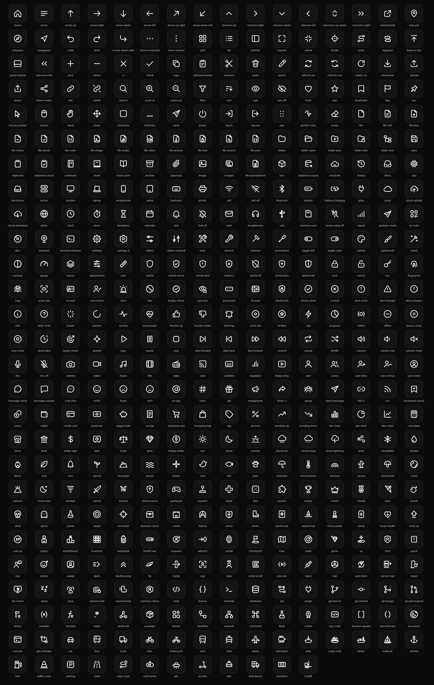

## Icon Gallery

Every icon, grouped by category. The name under each tile is what you pass to `AddTab`, tags, buttons and the rest of the API.

### Navigation (34)

<table>
<tr>
<td align="center" width="16%"><br><sub><code>home</code></sub></td>
<td align="center" width="16%"><br><sub><code>menu</code></sub></td>
<td align="center" width="16%"><br><sub><code>arrow-up</code></sub></td>
<td align="center" width="16%"><br><sub><code>arrow-right</code></sub></td>
<td align="center" width="16%"><br><sub><code>arrow-down</code></sub></td>
<td align="center" width="16%"><br><sub><code>arrow-left</code></sub></td>
</tr>
<tr>
<td align="center" width="16%"><br><sub><code>arrow-up-right</code></sub></td>
<td align="center" width="16%"><br><sub><code>arrow-down-left</code></sub></td>
<td align="center" width="16%"><br><sub><code>chevron-up</code></sub></td>
<td align="center" width="16%"><br><sub><code>chevron-right</code></sub></td>
<td align="center" width="16%"><br><sub><code>chevron-down</code></sub></td>
<td align="center" width="16%"><br><sub><code>chevron-left</code></sub></td>
</tr>
<tr>
<td align="center" width="16%"><br><sub><code>chevrons-up-down</code></sub></td>
<td align="center" width="16%"><br><sub><code>chevrons-right</code></sub></td>
<td align="center" width="16%"><br><sub><code>external-link</code></sub></td>
<td align="center" width="16%"><br><sub><code>map-pin</code></sub></td>
<td align="center" width="16%"><br><sub><code>compass</code></sub></td>
<td align="center" width="16%"><br><sub><code>navigation</code></sub></td>
</tr>
<tr>
<td align="center" width="16%"><br><sub><code>undo</code></sub></td>
<td align="center" width="16%"><br><sub><code>redo</code></sub></td>
<td align="center" width="16%"><br><sub><code>corner-down-right</code></sub></td>
<td align="center" width="16%"><br><sub><code>more-horizontal</code></sub></td>
<td align="center" width="16%"><br><sub><code>more-vertical</code></sub></td>
<td align="center" width="16%">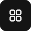<br><sub><code>grid</code></sub></td>
</tr>
<tr>
<td align="center" width="16%"><br><sub><code>list</code></sub></td>
<td align="center" width="16%"><br><sub><code>sidebar</code></sub></td>
<td align="center" width="16%"><br><sub><code>expand</code></sub></td>
<td align="center" width="16%"><br><sub><code>shrink</code></sub></td>
<td align="center" width="16%"><br><sub><code>locate</code></sub></td>
<td align="center" width="16%"><br><sub><code>route</code></sub></td>
</tr>
<tr>
<td align="center" width="16%"><br><sub><code>signpost</code></sub></td>
<td align="center" width="16%"><br><sub><code>back-to-top</code></sub></td>
<td align="center" width="16%"><br><sub><code>panel-bottom</code></sub></td>
<td align="center" width="16%"><br><sub><code>chevrons-left</code></sub></td>
<td></td>
<td></td>
</tr>
</table>

### Actions (43)

<table>
<tr>
<td align="center" width="16%"><br><sub><code>plus</code></sub></td>
<td align="center" width="16%"><br><sub><code>minus</code></sub></td>
<td align="center" width="16%"><br><sub><code>x</code></sub></td>
<td align="center" width="16%"><br><sub><code>check</code></sub></td>
<td align="center" width="16%"><br><sub><code>copy</code></sub></td>
<td align="center" width="16%"><br><sub><code>clipboard-paste</code></sub></td>
</tr>
<tr>
<td align="center" width="16%"><br><sub><code>scissors</code></sub></td>
<td align="center" width="16%"><br><sub><code>trash</code></sub></td>
<td align="center" width="16%"><br><sub><code>pencil</code></sub></td>
<td align="center" width="16%"><br><sub><code>refresh-cw</code></sub></td>
<td align="center" width="16%"><br><sub><code>refresh-ccw</code></sub></td>
<td align="center" width="16%"><br><sub><code>rotate-cw</code></sub></td>
</tr>
<tr>
<td align="center" width="16%"><br><sub><code>download</code></sub></td>
<td align="center" width="16%"><br><sub><code>upload</code></sub></td>
<td align="center" width="16%"><br><sub><code>share</code></sub></td>
<td align="center" width="16%"><br><sub><code>share-nodes</code></sub></td>
<td align="center" width="16%"><br><sub><code>link</code></sub></td>
<td align="center" width="16%"><br><sub><code>unlink</code></sub></td>
</tr>
<tr>
<td align="center" width="16%"><br><sub><code>search</code></sub></td>
<td align="center" width="16%"><br><sub><code>zoom-in</code></sub></td>
<td align="center" width="16%"><br><sub><code>zoom-out</code></sub></td>
<td align="center" width="16%"><br><sub><code>filter</code></sub></td>
<td align="center" width="16%"><br><sub><code>sort</code></sub></td>
<td align="center" width="16%"><br><sub><code>eye</code></sub></td>
</tr>
<tr>
<td align="center" width="16%"><br><sub><code>eye-off</code></sub></td>
<td align="center" width="16%"><br><sub><code>heart</code></sub></td>
<td align="center" width="16%"><br><sub><code>star</code></sub></td>
<td align="center" width="16%"><br><sub><code>bookmark</code></sub></td>
<td align="center" width="16%"><br><sub><code>flag</code></sub></td>
<td align="center" width="16%"><br><sub><code>pin</code></sub></td>
</tr>
<tr>
<td align="center" width="16%"><br><sub><code>mouse-pointer</code></sub></td>
<td align="center" width="16%">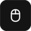<br><sub><code>mouse</code></sub></td>
<td align="center" width="16%"><br><sub><code>hand</code></sub></td>
<td align="center" width="16%"><br><sub><code>move</code></sub></td>
<td align="center" width="16%"><br><sub><code>maximize</code></sub></td>
<td align="center" width="16%"><br><sub><code>minimize</code></sub></td>
</tr>
<tr>
<td align="center" width="16%"><br><sub><code>send</code></sub></td>
<td align="center" width="16%"><br><sub><code>power</code></sub></td>
<td align="center" width="16%"><br><sub><code>log-in</code></sub></td>
<td align="center" width="16%"><br><sub><code>log-out</code></sub></td>
<td align="center" width="16%"><br><sub><code>grip</code></sub></td>
<td align="center" width="16%"><br><sub><code>pointer-click</code></sub></td>
</tr>
<tr>
<td align="center" width="16%"><br><sub><code>erase</code></sub></td>
<td></td>
<td></td>
<td></td>
<td></td>
<td></td>
</tr>
</table>

### Files (34)

<table>
<tr>
<td align="center" width="16%"><br><sub><code>file</code></sub></td>
<td align="center" width="16%"><br><sub><code>file-text</code></sub></td>
<td align="center" width="16%"><br><sub><code>file-plus</code></sub></td>
<td align="center" width="16%"><br><sub><code>file-minus</code></sub></td>
<td align="center" width="16%"><br><sub><code>file-check</code></sub></td>
<td align="center" width="16%"><br><sub><code>file-code</code></sub></td>
</tr>
<tr>
<td align="center" width="16%"><br><sub><code>file-image</code></sub></td>
<td align="center" width="16%"><br><sub><code>file-audio</code></sub></td>
<td align="center" width="16%"><br><sub><code>file-video</code></sub></td>
<td align="center" width="16%">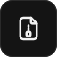<br><sub><code>file-archive</code></sub></td>
<td align="center" width="16%"><br><sub><code>file-lock</code></sub></td>
<td align="center" width="16%"><br><sub><code>file-search</code></sub></td>
</tr>
<tr>
<td align="center" width="16%"><br><sub><code>file-json</code></sub></td>
<td align="center" width="16%"><br><sub><code>folder</code></sub></td>
<td align="center" width="16%"><br><sub><code>folder-open</code></sub></td>
<td align="center" width="16%"><br><sub><code>folder-plus</code></sub></td>
<td align="center" width="16%"><br><sub><code>folder-lock</code></sub></td>
<td align="center" width="16%"><br><sub><code>folder-tree</code></sub></td>
</tr>
<tr>
<td align="center" width="16%"><br><sub><code>save</code></sub></td>
<td align="center" width="16%">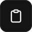<br><sub><code>clipboard</code></sub></td>
<td align="center" width="16%">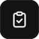<br><sub><code>clipboard-check</code></sub></td>
<td align="center" width="16%"><br><sub><code>notebook</code></sub></td>
<td align="center" width="16%"><br><sub><code>book</code></sub></td>
<td align="center" width="16%"><br><sub><code>book-open</code></sub></td>
</tr>
<tr>
<td align="center" width="16%"><br><sub><code>archive</code></sub></td>
<td align="center" width="16%"><br><sub><code>paperclip</code></sub></td>
<td align="center" width="16%"><br><sub><code>image</code></sub></td>
<td align="center" width="16%"><br><sub><code>images</code></sub></td>
<td align="center" width="16%"><br><sub><code>file-spreadsheet</code></sub></td>
<td align="center" width="16%">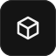<br><sub><code>box</code></sub></td>
</tr>
<tr>
<td align="center" width="16%">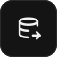<br><sub><code>database-export</code></sub></td>
<td align="center" width="16%"><br><sub><code>cloud-file</code></sub></td>
<td align="center" width="16%"><br><sub><code>history</code></sub></td>
<td align="center" width="16%"><br><sub><code>inbox</code></sub></td>
<td></td>
<td></td>
</tr>
</table>

### System (36)

<table>
<tr>
<td align="center" width="16%">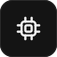<br><sub><code>cpu</code></sub></td>
<td align="center" width="16%"><br><sub><code>hard-drive</code></sub></td>
<td align="center" width="16%"><br><sub><code>server</code></sub></td>
<td align="center" width="16%"><br><sub><code>monitor</code></sub></td>
<td align="center" width="16%"><br><sub><code>laptop</code></sub></td>
<td align="center" width="16%"><br><sub><code>smartphone</code></sub></td>
</tr>
<tr>
<td align="center" width="16%"><br><sub><code>tablet</code></sub></td>
<td align="center" width="16%"><br><sub><code>keyboard</code></sub></td>
<td align="center" width="16%"><br><sub><code>printer</code></sub></td>
<td align="center" width="16%"><br><sub><code>wifi</code></sub></td>
<td align="center" width="16%"><br><sub><code>wifi-off</code></sub></td>
<td align="center" width="16%">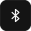<br><sub><code>bluetooth</code></sub></td>
</tr>
<tr>
<td align="center" width="16%"><br><sub><code>battery</code></sub></td>
<td align="center" width="16%"><br><sub><code>battery-charging</code></sub></td>
<td align="center" width="16%">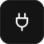<br><sub><code>plug</code></sub></td>
<td align="center" width="16%"><br><sub><code>cloud</code></sub></td>
<td align="center" width="16%"><br><sub><code>cloud-upload</code></sub></td>
<td align="center" width="16%"><br><sub><code>cloud-download</code></sub></td>
</tr>
<tr>
<td align="center" width="16%"><br><sub><code>globe</code></sub></td>
<td align="center" width="16%"><br><sub><code>clock</code></sub></td>
<td align="center" width="16%"><br><sub><code>timer</code></sub></td>
<td align="center" width="16%">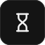<br><sub><code>hourglass</code></sub></td>
<td align="center" width="16%"><br><sub><code>calendar</code></sub></td>
<td align="center" width="16%"><br><sub><code>bell</code></sub></td>
</tr>
<tr>
<td align="center" width="16%"><br><sub><code>bell-off</code></sub></td>
<td align="center" width="16%"><br><sub><code>mail</code></sub></td>
<td align="center" width="16%"><br><sub><code>headphones</code></sub></td>
<td align="center" width="16%"><br><sub><code>usb</code></sub></td>
<td align="center" width="16%"><br><sub><code>memory-card</code></sub></td>
<td align="center" width="16%">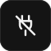<br><sub><code>power-plug-off</code></sub></td>
</tr>
<tr>
<td align="center" width="16%"><br><sub><code>signal</code></sub></td>
<td align="center" width="16%"><br><sub><code>airplane-mode</code></sub></td>
<td align="center" width="16%"><br><sub><code>qr-code</code></sub></td>
<td align="center" width="16%"><br><sub><code>disc</code></sub></td>
<td align="center" width="16%"><br><sub><code>webcam</code></sub></td>
<td align="center" width="16%"><br><sub><code>terminal-window</code></sub></td>
</tr>
</table>

### Settings (18)

<table>
<tr>
<td align="center" width="16%"><br><sub><code>settings</code></sub></td>
<td align="center" width="16%"><br><sub><code>settings-2</code></sub></td>
<td align="center" width="16%"><br><sub><code>sliders</code></sub></td>
<td align="center" width="16%">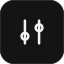<br><sub><code>sliders-vertical</code></sub></td>
<td align="center" width="16%"><br><sub><code>tools</code></sub></td>
<td align="center" width="16%"><br><sub><code>wrench</code></sub></td>
</tr>
<tr>
<td align="center" width="16%"><br><sub><code>hammer</code></sub></td>
<td align="center" width="16%"><br><sub><code>screwdriver</code></sub></td>
<td align="center" width="16%"><br><sub><code>toggle-left</code></sub></td>
<td align="center" width="16%"><br><sub><code>toggle-right</code></sub></td>
<td align="center" width="16%"><br><sub><code>palette</code></sub></td>
<td align="center" width="16%"><br><sub><code>paintbrush</code></sub></td>
</tr>
<tr>
<td align="center" width="16%">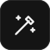<br><sub><code>wand</code></sub></td>
<td align="center" width="16%"><br><sub><code>contrast</code></sub></td>
<td align="center" width="16%"><br><sub><code>gauge</code></sub></td>
<td align="center" width="16%"><br><sub><code>layers</code></sub></td>
<td align="center" width="16%">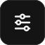<br><sub><code>adjustments</code></sub></td>
<td align="center" width="16%"><br><sub><code>ruler</code></sub></td>
</tr>
</table>

### Security (22)

<table>
<tr>
<td align="center" width="16%"><br><sub><code>shield</code></sub></td>
<td align="center" width="16%"><br><sub><code>shield-check</code></sub></td>
<td align="center" width="16%"><br><sub><code>shield-alert</code></sub></td>
<td align="center" width="16%"><br><sub><code>shield-x</code></sub></td>
<td align="center" width="16%"><br><sub><code>shield-off</code></sub></td>
<td align="center" width="16%"><br><sub><code>shield-plus</code></sub></td>
</tr>
<tr>
<td align="center" width="16%"><br><sub><code>shield-half</code></sub></td>
<td align="center" width="16%"><br><sub><code>lock</code></sub></td>
<td align="center" width="16%"><br><sub><code>unlock</code></sub></td>
<td align="center" width="16%"><br><sub><code>key</code></sub></td>
<td align="center" width="16%"><br><sub><code>fingerprint</code></sub></td>
<td align="center" width="16%"><br><sub><code>bug</code></sub></td>
</tr>
<tr>
<td align="center" width="16%"><br><sub><code>scan-eye</code></sub></td>
<td align="center" width="16%"><br><sub><code>id-card</code></sub></td>
<td align="center" width="16%"><br><sub><code>user-check</code></sub></td>
<td align="center" width="16%">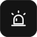<br><sub><code>siren</code></sub></td>
<td align="center" width="16%"><br><sub><code>ban</code></sub></td>
<td align="center" width="16%"><br><sub><code>badge-check</code></sub></td>
</tr>
<tr>
<td align="center" width="16%"><br><sub><code>eye-lock</code></sub></td>
<td align="center" width="16%"><br><sub><code>password</code></sub></td>
<td align="center" width="16%"><br><sub><code>firewall</code></sub></td>
<td align="center" width="16%"><br><sub><code>shield-lock</code></sub></td>
<td></td>
<td></td>
</tr>
</table>

### Status (25)

<table>
<tr>
<td align="center" width="16%"><br><sub><code>check-circle</code></sub></td>
<td align="center" width="16%"><br><sub><code>x-circle</code></sub></td>
<td align="center" width="16%"><br><sub><code>alert-circle</code></sub></td>
<td align="center" width="16%"><br><sub><code>alert-triangle</code></sub></td>
<td align="center" width="16%"><br><sub><code>alert-octagon</code></sub></td>
<td align="center" width="16%"><br><sub><code>info</code></sub></td>
</tr>
<tr>
<td align="center" width="16%"><br><sub><code>help-circle</code></sub></td>
<td align="center" width="16%"><br><sub><code>loader</code></sub></td>
<td align="center" width="16%"><br><sub><code>spinner</code></sub></td>
<td align="center" width="16%"><br><sub><code>activity</code></sub></td>
<td align="center" width="16%"><br><sub><code>heart-pulse</code></sub></td>
<td align="center" width="16%"><br><sub><code>thumbs-up</code></sub></td>
</tr>
<tr>
<td align="center" width="16%"><br><sub><code>thumbs-down</code></sub></td>
<td align="center" width="16%"><br><sub><code>bell-ring</code></sub></td>
<td align="center" width="16%"><br><sub><code>circle-dot</code></sub></td>
<td align="center" width="16%"><br><sub><code>verified</code></sub></td>
<td align="center" width="16%"><br><sub><code>zap</code></sub></td>
<td align="center" width="16%"><br><sub><code>progress</code></sub></td>
</tr>
<tr>
<td align="center" width="16%"><br><sub><code>online</code></sub></td>
<td align="center" width="16%"><br><sub><code>offline</code></sub></td>
<td align="center" width="16%"><br><sub><code>pause-circle</code></sub></td>
<td align="center" width="16%"><br><sub><code>stop-circle</code></sub></td>
<td align="center" width="16%"><br><sub><code>clock-alert</code></sub></td>
<td align="center" width="16%"><br><sub><code>target-check</code></sub></td>
</tr>
<tr>
<td align="center" width="16%"><br><sub><code>sparkle</code></sub></td>
<td></td>
<td></td>
<td></td>
<td></td>
<td></td>
</tr>
</table>

### Media (23)

<table>
<tr>
<td align="center" width="16%"><br><sub><code>play</code></sub></td>
<td align="center" width="16%"><br><sub><code>pause</code></sub></td>
<td align="center" width="16%"><br><sub><code>stop</code></sub></td>
<td align="center" width="16%"><br><sub><code>skip-forward</code></sub></td>
<td align="center" width="16%"><br><sub><code>skip-back</code></sub></td>
<td align="center" width="16%"><br><sub><code>fast-forward</code></sub></td>
</tr>
<tr>
<td align="center" width="16%"><br><sub><code>rewind</code></sub></td>
<td align="center" width="16%"><br><sub><code>repeat</code></sub></td>
<td align="center" width="16%"><br><sub><code>shuffle</code></sub></td>
<td align="center" width="16%"><br><sub><code>volume</code></sub></td>
<td align="center" width="16%"><br><sub><code>volume-low</code></sub></td>
<td align="center" width="16%"><br><sub><code>volume-mute</code></sub></td>
</tr>
<tr>
<td align="center" width="16%"><br><sub><code>mic</code></sub></td>
<td align="center" width="16%"><br><sub><code>mic-off</code></sub></td>
<td align="center" width="16%"><br><sub><code>camera</code></sub></td>
<td align="center" width="16%"><br><sub><code>video</code></sub></td>
<td align="center" width="16%"><br><sub><code>music</code></sub></td>
<td align="center" width="16%">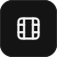<br><sub><code>film</code></sub></td>
</tr>
<tr>
<td align="center" width="16%"><br><sub><code>radio</code></sub></td>
<td align="center" width="16%"><br><sub><code>cast</code></sub></td>
<td align="center" width="16%"><br><sub><code>subtitles</code></sub></td>
<td align="center" width="16%"><br><sub><code>equalizer</code></sub></td>
<td align="center" width="16%"><br><sub><code>image-play</code></sub></td>
<td></td>
</tr>
</table>

### Social (21)

<table>
<tr>
<td align="center" width="16%"><br><sub><code>user</code></sub></td>
<td align="center" width="16%"><br><sub><code>users</code></sub></td>
<td align="center" width="16%"><br><sub><code>user-plus</code></sub></td>
<td align="center" width="16%"><br><sub><code>user-minus</code></sub></td>
<td align="center" width="16%"><br><sub><code>user-circle</code></sub></td>
<td align="center" width="16%"><br><sub><code>message-circle</code></sub></td>
</tr>
<tr>
<td align="center" width="16%"><br><sub><code>message-square</code></sub></td>
<td align="center" width="16%"><br><sub><code>chat-dots</code></sub></td>
<td align="center" width="16%"><br><sub><code>smile</code></sub></td>
<td align="center" width="16%"><br><sub><code>frown</code></sub></td>
<td align="center" width="16%"><br><sub><code>meh</code></sub></td>
<td align="center" width="16%"><br><sub><code>at-sign</code></sub></td>
</tr>
<tr>
<td align="center" width="16%">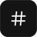<br><sub><code>hash</code></sub></td>
<td align="center" width="16%"><br><sub><code>gift</code></sub></td>
<td align="center" width="16%"><br><sub><code>megaphone</code></sub></td>
<td align="center" width="16%"><br><sub><code>share-2</code></sub></td>
<td align="center" width="16%"><br><sub><code>group</code></sub></td>
<td align="center" width="16%"><br><sub><code>send-message</code></sub></td>
</tr>
<tr>
<td align="center" width="16%"><br><sub><code>link-2</code></sub></td>
<td align="center" width="16%"><br><sub><code>rss</code></sub></td>
<td align="center" width="16%"><br><sub><code>bookmark-check</code></sub></td>
<td></td>
<td></td>
<td></td>
</tr>
</table>

### Finance (23)

<table>
<tr>
<td align="center" width="16%"><br><sub><code>coins</code></sub></td>
<td align="center" width="16%"><br><sub><code>wallet</code></sub></td>
<td align="center" width="16%"><br><sub><code>credit-card</code></sub></td>
<td align="center" width="16%"><br><sub><code>banknote</code></sub></td>
<td align="center" width="16%"><br><sub><code>piggy-bank</code></sub></td>
<td align="center" width="16%"><br><sub><code>receipt</code></sub></td>
</tr>
<tr>
<td align="center" width="16%"><br><sub><code>shopping-cart</code></sub></td>
<td align="center" width="16%"><br><sub><code>shopping-bag</code></sub></td>
<td align="center" width="16%"><br><sub><code>tag</code></sub></td>
<td align="center" width="16%"><br><sub><code>percent</code></sub></td>
<td align="center" width="16%"><br><sub><code>trending-up</code></sub></td>
<td align="center" width="16%"><br><sub><code>trending-down</code></sub></td>
</tr>
<tr>
<td align="center" width="16%"><br><sub><code>bar-chart</code></sub></td>
<td align="center" width="16%"><br><sub><code>pie-chart</code></sub></td>
<td align="center" width="16%"><br><sub><code>line-chart</code></sub></td>
<td align="center" width="16%"><br><sub><code>calculator</code></sub></td>
<td align="center" width="16%"><br><sub><code>store</code></sub></td>
<td align="center" width="16%"><br><sub><code>bank</code></sub></td>
</tr>
<tr>
<td align="center" width="16%"><br><sub><code>dollar-sign</code></sub></td>
<td align="center" width="16%"><br><sub><code>safe</code></sub></td>
<td align="center" width="16%"><br><sub><code>scale</code></sub></td>
<td align="center" width="16%"><br><sub><code>gem</code></sub></td>
<td align="center" width="16%"><br><sub><code>badge-dollar</code></sub></td>
<td></td>
</tr>
</table>

### Nature (28)

<table>
<tr>
<td align="center" width="16%"><br><sub><code>sun</code></sub></td>
<td align="center" width="16%"><br><sub><code>moon</code></sub></td>
<td align="center" width="16%">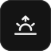<br><sub><code>sunrise</code></sub></td>
<td align="center" width="16%">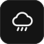<br><sub><code>cloud-rain</code></sub></td>
<td align="center" width="16%"><br><sub><code>cloud-snow</code></sub></td>
<td align="center" width="16%"><br><sub><code>cloud-lightning</code></sub></td>
</tr>
<tr>
<td align="center" width="16%"><br><sub><code>wind</code></sub></td>
<td align="center" width="16%">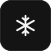<br><sub><code>snowflake</code></sub></td>
<td align="center" width="16%"><br><sub><code>droplet</code></sub></td>
<td align="center" width="16%"><br><sub><code>flame</code></sub></td>
<td align="center" width="16%"><br><sub><code>leaf</code></sub></td>
<td align="center" width="16%"><br><sub><code>tree</code></sub></td>
</tr>
<tr>
<td align="center" width="16%"><br><sub><code>sprout</code></sub></td>
<td align="center" width="16%"><br><sub><code>mountain</code></sub></td>
<td align="center" width="16%"><br><sub><code>waves</code></sub></td>
<td align="center" width="16%"><br><sub><code>flower</code></sub></td>
<td align="center" width="16%"><br><sub><code>bird</code></sub></td>
<td align="center" width="16%"><br><sub><code>fish</code></sub></td>
</tr>
<tr>
<td align="center" width="16%"><br><sub><code>paw</code></sub></td>
<td align="center" width="16%"><br><sub><code>umbrella</code></sub></td>
<td align="center" width="16%"><br><sub><code>thermometer</code></sub></td>
<td align="center" width="16%"><br><sub><code>rainbow</code></sub></td>
<td align="center" width="16%"><br><sub><code>cactus</code></sub></td>
<td align="center" width="16%"><br><sub><code>mushroom</code></sub></td>
</tr>
<tr>
<td align="center" width="16%"><br><sub><code>earth</code></sub></td>
<td align="center" width="16%">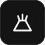<br><sub><code>volcano</code></sub></td>
<td align="center" width="16%"><br><sub><code>moon-star</code></sub></td>
<td align="center" width="16%"><br><sub><code>tornado</code></sub></td>
<td></td>
<td></td>
</tr>
</table>

### Gaming (30)

<table>
<tr>
<td align="center" width="16%"><br><sub><code>sword</code></sub></td>
<td align="center" width="16%"><br><sub><code>swords</code></sub></td>
<td align="center" width="16%"><br><sub><code>shield-sword</code></sub></td>
<td align="center" width="16%"><br><sub><code>gamepad</code></sub></td>
<td align="center" width="16%"><br><sub><code>joystick</code></sub></td>
<td align="center" width="16%"><br><sub><code>dpad</code></sub></td>
</tr>
<tr>
<td align="center" width="16%">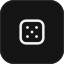<br><sub><code>dice</code></sub></td>
<td align="center" width="16%"><br><sub><code>puzzle</code></sub></td>
<td align="center" width="16%"><br><sub><code>trophy</code></sub></td>
<td align="center" width="16%"><br><sub><code>crown</code></sub></td>
<td align="center" width="16%"><br><sub><code>medal</code></sub></td>
<td align="center" width="16%"><br><sub><code>bow</code></sub></td>
</tr>
<tr>
<td align="center" width="16%"><br><sub><code>bomb</code></sub></td>
<td align="center" width="16%"><br><sub><code>skull</code></sub></td>
<td align="center" width="16%"><br><sub><code>ghost</code></sub></td>
<td align="center" width="16%"><br><sub><code>potion</code></sub></td>
<td align="center" width="16%"><br><sub><code>target</code></sub></td>
<td align="center" width="16%"><br><sub><code>crosshair</code></sub></td>
</tr>
<tr>
<td align="center" width="16%"><br><sub><code>treasure-chest</code></sub></td>
<td align="center" width="16%"><br><sub><code>castle</code></sub></td>
<td align="center" width="16%"><br><sub><code>helmet</code></sub></td>
<td align="center" width="16%"><br><sub><code>armor</code></sub></td>
<td align="center" width="16%"><br><sub><code>boots</code></sub></td>
<td align="center" width="16%"><br><sub><code>spell-book</code></sub></td>
</tr>
<tr>
<td align="center" width="16%">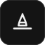<br><sub><code>wizard-hat</code></sub></td>
<td align="center" width="16%"><br><sub><code>chess-pawn</code></sub></td>
<td align="center" width="16%"><br><sub><code>cards</code></sub></td>
<td align="center" width="16%"><br><sub><code>heart-health</code></sub></td>
<td align="center" width="16%"><br><sub><code>level-up</code></sub></td>
<td align="center" width="16%"><br><sub><code>coin-xp</code></sub></td>
</tr>
</table>

### Roblox Ui (37)

<table>
<tr>
<td align="center" width="16%"><br><sub><code>player</code></sub></td>
<td align="center" width="16%"><br><sub><code>leaderboard</code></sub></td>
<td align="center" width="16%"><br><sub><code>inventory</code></sub></td>
<td align="center" width="16%">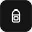<br><sub><code>backpack</code></sub></td>
<td align="center" width="16%"><br><sub><code>health-bar</code></sub></td>
<td align="center" width="16%"><br><sub><code>respawn</code></sub></td>
</tr>
<tr>
<td align="center" width="16%">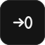<br><sub><code>teleport</code></sub></td>
<td align="center" width="16%"><br><sub><code>portal</code></sub></td>
<td align="center" width="16%"><br><sub><code>checkpoint</code></sub></td>
<td align="center" width="16%"><br><sub><code>map</code></sub></td>
<td align="center" width="16%"><br><sub><code>radar</code></sub></td>
<td align="center" width="16%"><br><sub><code>gems</code></sub></td>
</tr>
<tr>
<td align="center" width="16%">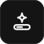<br><sub><code>xp</code></sub></td>
<td align="center" width="16%"><br><sub><code>rank</code></sub></td>
<td align="center" width="16%"><br><sub><code>quest</code></sub></td>
<td align="center" width="16%"><br><sub><code>npc</code></sub></td>
<td align="center" width="16%"><br><sub><code>emote</code></sub></td>
<td align="center" width="16%"><br><sub><code>avatar</code></sub></td>
</tr>
<tr>
<td align="center" width="16%"><br><sub><code>dash</code></sub></td>
<td align="center" width="16%"><br><sub><code>double-jump</code></sub></td>
<td align="center" width="16%"><br><sub><code>fly</code></sub></td>
<td align="center" width="16%"><br><sub><code>noclip</code></sub></td>
<td align="center" width="16%"><br><sub><code>esp</code></sub></td>
<td align="center" width="16%"><br><sub><code>halo</code></sub></td>
</tr>
<tr>
<td align="center" width="16%"><br><sub><code>script-scroll</code></sub></td>
<td align="center" width="16%"><br><sub><code>execute</code></sub></td>
<td align="center" width="16%"><br><sub><code>inject</code></sub></td>
<td align="center" width="16%"><br><sub><code>hub</code></sub></td>
<td align="center" width="16%"><br><sub><code>auto-farm</code></sub></td>
<td align="center" width="16%"><br><sub><code>server-hop</code></sub></td>
</tr>
<tr>
<td align="center" width="16%"><br><sub><code>rejoin</code></sub></td>
<td align="center" width="16%">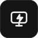<br><sub><code>fps-boost</code></sub></td>
<td align="center" width="16%"><br><sub><code>sleep</code></sub></td>
<td align="center" width="16%"><br><sub><code>aura</code></sub></td>
<td align="center" width="16%"><br><sub><code>camera-lock</code></sub></td>
<td align="center" width="16%"><br><sub><code>speed-boots</code></sub></td>
</tr>
<tr>
<td align="center" width="16%"><br><sub><code>currency-robux</code></sub></td>
<td></td>
<td></td>
<td></td>
<td></td>
<td></td>
</tr>
</table>

### Developer Tools (28)

<table>
<tr>
<td align="center" width="16%"><br><sub><code>code</code></sub></td>
<td align="center" width="16%">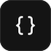<br><sub><code>braces</code></sub></td>
<td align="center" width="16%"><br><sub><code>terminal</code></sub></td>
<td align="center" width="16%"><br><sub><code>database</code></sub></td>
<td align="center" width="16%"><br><sub><code>api</code></sub></td>
<td align="center" width="16%"><br><sub><code>plugin</code></sub></td>
</tr>
<tr>
<td align="center" width="16%"><br><sub><code>git-branch</code></sub></td>
<td align="center" width="16%"><br><sub><code>git-commit</code></sub></td>
<td align="center" width="16%"><br><sub><code>git-merge</code></sub></td>
<td align="center" width="16%">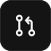<br><sub><code>git-pull-request</code></sub></td>
<td align="center" width="16%"><br><sub><code>binary</code></sub></td>
<td align="center" width="16%"><br><sub><code>variable</code></sub></td>
</tr>
<tr>
<td align="center" width="16%">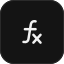<br><sub><code>function</code></sub></td>
<td align="center" width="16%"><br><sub><code>regex</code></sub></td>
<td align="center" width="16%"><br><sub><code>webhook</code></sub></td>
<td align="center" width="16%">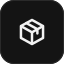<br><sub><code>package</code></sub></td>
<td align="center" width="16%"><br><sub><code>blocks</code></sub></td>
<td align="center" width="16%"><br><sub><code>workflow</code></sub></td>
</tr>
<tr>
<td align="center" width="16%"><br><sub><code>network</code></sub></td>
<td align="center" width="16%">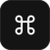<br><sub><code>command</code></sub></td>
<td align="center" width="16%"><br><sub><code>flask</code></sub></td>
<td align="center" width="16%"><br><sub><code>rocket</code></sub></td>
<td align="center" width="16%"><br><sub><code>key-code</code></sub></td>
<td align="center" width="16%"><br><sub><code>bracket-square</code></sub></td>
</tr>
<tr>
<td align="center" width="16%"><br><sub><code>parentheses</code></sub></td>
<td align="center" width="16%"><br><sub><code>lua-moon</code></sub></td>
<td align="center" width="16%">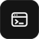<br><sub><code>console</code></sub></td>
<td align="center" width="16%">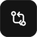<br><sub><code>git-compare</code></sub></td>
<td></td>
<td></td>
</tr>
</table>

### Transportation (26)

<table>
<tr>
<td align="center" width="16%"><br><sub><code>car</code></sub></td>
<td align="center" width="16%"><br><sub><code>bus</code></sub></td>
<td align="center" width="16%"><br><sub><code>truck</code></sub></td>
<td align="center" width="16%"><br><sub><code>bike</code></sub></td>
<td align="center" width="16%"><br><sub><code>motorcycle</code></sub></td>
<td align="center" width="16%"><br><sub><code>train</code></sub></td>
</tr>
<tr>
<td align="center" width="16%"><br><sub><code>tram</code></sub></td>
<td align="center" width="16%"><br><sub><code>plane</code></sub></td>
<td align="center" width="16%"><br><sub><code>helicopter</code></sub></td>
<td align="center" width="16%">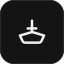<br><sub><code>ship</code></sub></td>
<td align="center" width="16%"><br><sub><code>cargo-ship</code></sub></td>
<td align="center" width="16%"><br><sub><code>tanker</code></sub></td>
</tr>
<tr>
<td align="center" width="16%"><br><sub><code>sailboat</code></sub></td>
<td align="center" width="16%"><br><sub><code>anchor</code></sub></td>
<td align="center" width="16%"><br><sub><code>fuel</code></sub></td>
<td align="center" width="16%"><br><sub><code>traffic-cone</code></sub></td>
<td align="center" width="16%"><br><sub><code>parking</code></sub></td>
<td align="center" width="16%"><br><sub><code>road</code></sub></td>
</tr>
<tr>
<td align="center" width="16%"><br><sub><code>map-route</code></sub></td>
<td align="center" width="16%"><br><sub><code>submarine</code></sub></td>
<td align="center" width="16%"><br><sub><code>ufo</code></sub></td>
<td align="center" width="16%"><br><sub><code>scooter</code></sub></td>
<td align="center" width="16%"><br><sub><code>taxi</code></sub></td>
<td align="center" width="16%"><br><sub><code>ambulance</code></sub></td>
</tr>
<tr>
<td align="center" width="16%"><br><sub><code>container</code></sub></td>
<td align="center" width="16%"><br><sub><code>forklift</code></sub></td>
<td></td>
<td></td>
<td></td>
<td></td>
</tr>
</table>


## Validation Report

What was actually checked for this release, and how.

**Icon pack**
- 428 icons in 15 categories, each in 3 variants (outline, filled, duotone) plus a preview tile
- SVG structure check on every file: well-formed XML, `viewBox="0 0 24 24"` on every outline/filled/duotone file, only `path`, `circle`, `rect`, `g`, `mask` and `defs` elements, no scripts, links or external references
- Name check: unique kebab-case names, the same names in all variants and in `manifest.json`
- Geometry check: no two icons with identical geometry
- Visual check: every outline icon was rendered in Chromium and the contact sheets were looked at category by category. `sword`, `refresh-cw` and `tools` were redrawn from scratch and inspected at large and small sizes. Filled variants were rendered and inspected for every category; duotone variants were rendered and inspected as samples, not one by one.

**Library (`Mugi`)**
- Compiled and statically analyzed with the real Luau compiler: no syntax errors
- Source check: line 1 is the only comment in the file, no non-ASCII characters (no emoji), no pink colors (the only magenta is a keypoint of the hue spectrum in the color picker)
- Run in a simulated Roblox environment (a strict mock that rejects unknown properties and wrong value types, with a fake file system and HTTP): window creation, every component, tags with icons, tab icons, search icon, notifications, popup color picker (hex, RGB, presets, cancel, done), background via link and via `og:image` page, bubble customization, all 428 icons drawing without errors, config save/load/delete with the HWID-or-account rule (same account other device: visible; other account same device: visible; both changed: hidden), delete confirmation, auto save, notification cleanup and full cleanup on `Destroy`
- **Not tested in the real Roblox client or in a real executor.** Behavior that depends on executor functions (`request`, `getcustomasset`, `gethwid`, file functions) follows their documented behavior but could differ per executor.

**Thumbnail**
- The thumbnail at the top of this file uses the Dropbox link you provided (`raw=1`). Dropbox could not be reached from the build environment, so the image was **not** downloaded or checked there. If it does not show on GitHub, download the image once, save it as `assets/thumbnail.png`, and replace the `src` of the first `` with `assets/thumbnail.png`.

## Troubleshooting

**`attempt to call a nil value` right after the `loadstring` line**
The library failed to load - usually a stale GitHub raw cache shortly after a push
